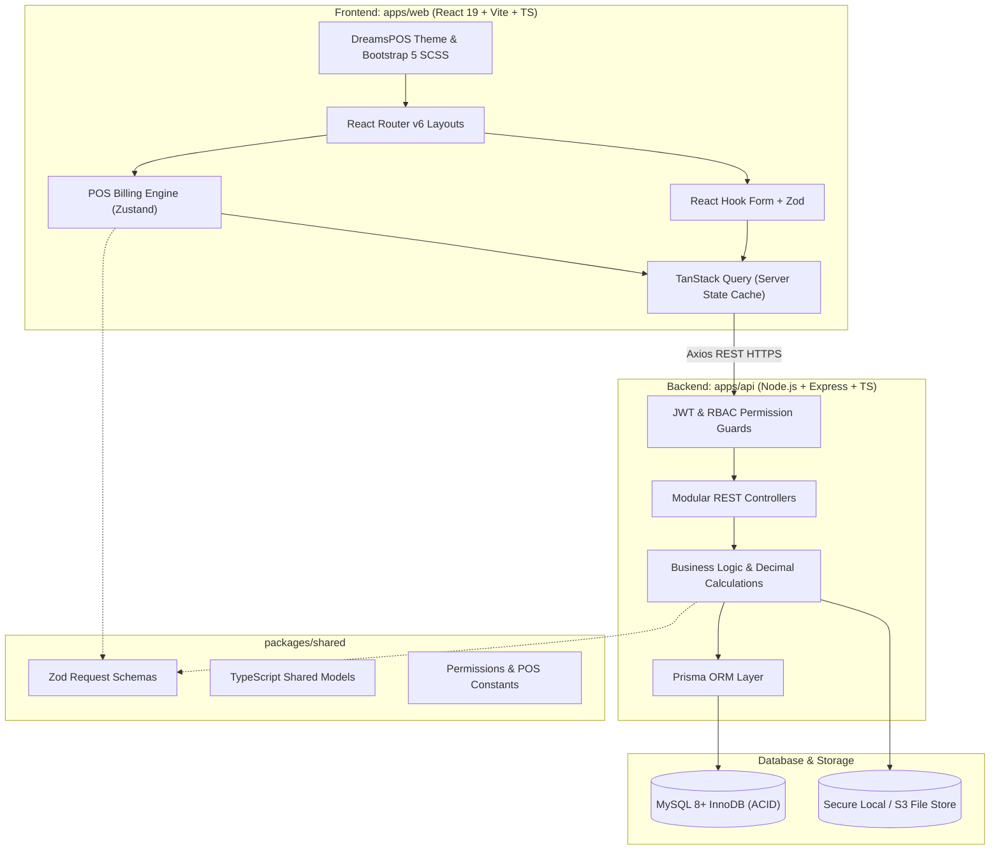

# DreamsPOS System Architecture

## 1. High-Level Architecture Overview

DreamsPOS is an enterprise-grade Retail Point of Sale and Business Management System structured as a high-performance modular monorepo. It couples an ultra-fast React 19 + TypeScript frontend with a transactional Node.js / Express.js + Prisma ORM + MySQL 8 backend.



---

## 2. Monorepo Directory Layout

```
d:\Dreams POS\
├── apps/
│   ├── web/                 # React 19 + Vite + TypeScript frontend
│   │   ├── src/
│   │   │   ├── core/        # Common utilities, modals, state hooks, loaders
│   │   │   ├── feature-module/ # POS, inventory, sales, purchases, finance, hrm, reports, settings
│   │   │   ├── InitialPage/ # Sidebar (default, mini, horizontal, 2-col), Header
│   │   │   ├── Router/      # React Router link definitions & page route registry
│   │   │   ├── style/       # SCSS stylesheets, variables, mixins, custom styling
│   │   │   └── App.tsx
│   │   ├── public/assets/   # Licensed images, icons, fonts, plugins
│   │   └── vite.config.ts
│   │
│   └── api/                 # Node.js + Express + TypeScript backend
│       ├── src/
│       │   ├── config/      # Environment variables, database client, logger
│       │   ├── middleware/  # Auth JWT, role-based guard, rate-limiting, error handler
│       │   ├── modules/     # Feature-grouped routes, controllers, services
│       │   │   ├── auth/
│       │   │   ├── dashboard/
│       │   │   ├── products/
│       │   │   ├── pos/
│       │   │   ├── sales/
│       │   │   ├── stock/
│       │   │   ├── purchases/
│       │   │   ├── customers/
│       │   │   ├── suppliers/
│       │   │   ├── finance/
│       │   │   ├── hrm/
│       │   │   ├── reports/
│       │   │   ├── settings/
│       │   │   └── users/
│       │   ├── utils/       # Decimal math, receipt formatter, audit logger
│       │   └── app.ts
│       └── tsconfig.json
│
├── packages/
│   └── shared/              # Shared types, Zod schemas, constants
│       ├── src/
│       │   ├── dtos/
│       │   ├── permissions/
│       │   └── index.ts
│       └── package.json
│
├── database/                # Prisma schema, migrations, seeders
│   ├── prisma/
│   │   └── schema.prisma
│   └── seed/
│       └── seed.ts
│
├── docker/                  # Dockerfiles and compose definitions
│   ├── Dockerfile.web
│   ├── Dockerfile.api
│   └── docker-compose.yml
│
├── docs/                    # Exhaustive specifications & checklists
│   ├── PAGE_INVENTORY.md
│   ├── FEATURE_MATRIX.md
│   ├── VISUAL_PARITY_CHECKLIST.md
│   ├── DATABASE_SCHEMA.md
│   ├── ARCHITECTURE.md
│   ├── API_DOCUMENTATION.md
│   ├── IMPLEMENTATION_PROGRESS.md
│   └── KNOWN_LIMITATIONS.md
│
├── original_template/       # Preserved licensed template source (HTML & React)
│   ├── html/
│   └── react/
│
├── docker-compose.yml
├── .env.example
├── README.md
└── INSTALLATION.md
```

---

## 3. Core Architectural Principles

1. **Strict Visual Parity**:
   The frontend uses the exact CSS classes, SCSS design tokens (`#FE9F43`, `#092C4C`), fonts, and icon assets from the licensed DreamsPOS bundle. No generic UI replacements are permitted.

2. **Decimal-Safe Monetary Arithmetic**:
   All financial values (line totals, tax calculations, discounts, split tender sums, ledger credits/debits) use fixed-precision decimal arithmetic (via Decimal.js or integer cents representation) to prevent IEEE 754 floating-point errors.

3. **Atomic Multi-Table Transactions**:
   Checkout operations, stock adjustments, and inventory transfers are wrapped inside database transactions (`prisma.$transaction`). Either the entire invoice, payment, and stock deduction commit together, or none do.

4. **Layered Authorization & RBAC**:
   Authentication uses short-lived JWT access tokens accompanied by HttpOnly refresh tokens with rotation. Route access is controlled by both frontend guards and server-side RBAC middleware.

5. **Hardware Scanner & Thermal Receipt Readiness**:
   The POS engine incorporates a native barcode wedge listener hook and standard 58mm/80mm thermal receipt styles compatible with standard browser printing and ESC/POS printer protocols.
